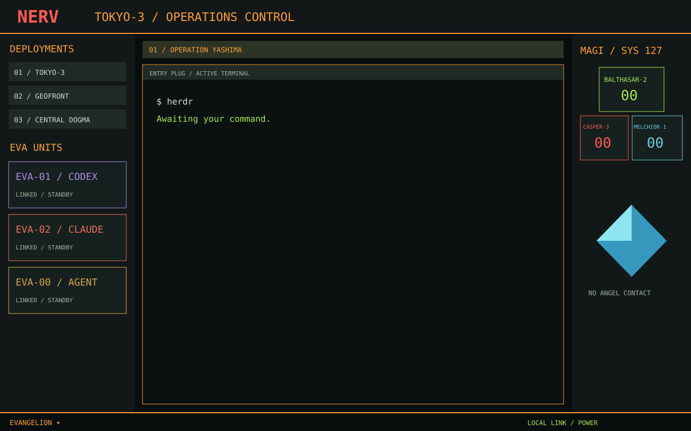

# Evangelion · NERV Operations

**Your agents are the EVA units. Your workspaces are deployments. The MAGI watches for the next request that needs you.**

A native Herdr layout inspired by Evangelion's command screens: condensed technical labels, orange dividers, purple and red unit liveries, and a quieter place for the terminals where the real work happens.



*Original illustrated preview, not a live workspace screenshot. All helmets, Angel silhouettes and interface artwork are original SVG drawings.*

## Enter the command center

The console surrounds your existing terminals with real Herdr data. A blocked agent becomes an input request; clicking its unit takes you straight to its terminal.

| Console | What you can do |
| --- | --- |
| **DEPLOYMENTS** | Select actual workspaces; right-click for Herdr's workspace actions. |
| **OPERATIONS** | Navigate tabs, open the agent/terminal launcher, and keep real names visible. |
| **EVA UNITS** | Focus an agent; open DETAILS to choose its persistent EVA-00, EVA-01 or EVA-02 livery. Titles and terminal addresses stay visible. |
| **MAGI** | MELCHIOR-1 counts working agents; BALTHASAR-2 counts completed agents; CASPER-3 counts input requests. Click a channel to filter the list. |
| **CONTACT SIGNALS** | Find agents that need you, accompanied by Ramiel and Sachiel silhouettes. |
| **UMBILICAL LINKS** | See local and connected machines with their actual readiness. |
| **EVANGELION ▾** | Open the native layout menu, see the current layout, and switch from the console. |

Codex starts in EVA-01 colors, Claude in EVA-02, and other agents in EVA-00. These are changeable costumes, not canonical pilot assignments or changes to model behavior. MAGI summarizes actual states; it creates no extra agents or approval system.

The side panels resize, the MAGI monitor can be hidden, and terminal headers keep split and zoom controls nearby. `?` opens the operations manual. **MOTION** turns off decorative native pulses. There are no automatic sounds or alarm interruptions.

### Optional pane names

Install [Pane Rename](https://github.com/avihut/herdr-pane-rename) to give entry-plug terminals persistent custom titles through the pane menu or its Cmd+F2 shortcut. Blank names restore automatic titles. The integration keeps the clicked pane as its target and falls back to the ordinary menu when the optional capability is unavailable.

## Two training exercises

Open **SIM** in the top bar. Both games run locally and leave your agents and terminals alone.

### Episode 13 · Ireul containment

An infected 5×5 grid has reached the MAGI simulation. Clicking a sector toggles it and its four orthogonal neighbors. Clear every infected sector to contain the intrusion.

Every board is generated by legal moves and has a solution. **UNDO** lets you reconsider, **MAGI HINT** suggests a move toward containment, and **NEW GRID** starts another exercise. Your best move count is saved locally.

### Episode 09 · Israfel synchronization

Find eight matching pairs in a 4×4 grid of EVA units, Angels and familiar objects. Matching cards remain exposed; after a mismatch, **CONTINUE** turns them back over when you are ready. There is no countdown rushing your next move. Your best attempt count is saved locally.

Win either exercise for a native **CONGRATULATIONS / おめでとう** title card. These are original puzzle adaptations inspired by the episodes, not reproductions of fictional software from the anime.

## There is more below Central Dogma

The operations manual offers hints. A certain refrigerator is occupied, and persistent curiosity around the command emblems opens another channel.

<details>
<summary><strong>Classified: reveal easter eggs</strong></summary>

- Tap the **NERV emblem three times**, or the **MAGI heading seven times**, to open the SEELE archive.
- Its seven-eye monolith carries a **CASPER-3 refusal**. Your terminals remain separate and your agents keep their identities.
- Choose **REFRIGERATION / 02**, open the refrigerator, and ask **WARK?** for Pen Pen's rotating off-duty messages.
- Complete the training exercises to mark their discoveries in the archive.

None sends prompts, changes permissions, closes workspaces or runs surprise terminal commands.

</details>

## Dark command screens, light paper controls

Dark appearance carries the orange, green and purple command-screen palette. Light appearance adapts the chrome to warm paper with stronger accent contrast.

**Both keep dark terminal surfaces.** Running terminal applications can retain dark backgrounds and true-color text; this keeps Codex prompts, diffs and output readable while surrounding controls follow your appearance. The light design is a deliberate adaptation.

| Host indicator | Meaning |
| --- | --- |
| Network glyph / LINK | Local network availability; **not proof of Internet access**. Hover for interfaces and sample time. |
| Battery glyph | Detected internal battery percentage, AC and charging state; absent on machines without battery hardware. |
| Unknown | Failed or unavailable probe, without invented readings. |
| Remote machines | Separate Herdr readiness in UMBILICAL LINKS. |

macOS telemetry reads `scutil --nwi` and `pmset -g batt` every 30 seconds. Other platforms currently show unknown network status and no battery icon. No external connectivity service is contacted.

## Install

You need Herdr and Python 3.10 or later. Node and pnpm are only for development tests. The layout itself needs no browser, server or package installation.

With daft:

```sh
daft clone https://github.com/avihut/herdr-evangelion --layout contained
cd herdr-evangelion/main
python3 scripts/install.py --dry-run
python3 scripts/install.py
```

Or download and extract this repository, then run the Python installer from its root. Review source before trusting repository environment hooks.

Select **Evangelion** from your layout menu or Settings → Layouts. Installation does not switch the current layout or change global settings, keys, shared state or other layouts. The native menu follows personal replacement/title conventions and marks the active layout.

Existing Evangelion files are refused by default. To deliberately update:

```sh
python3 scripts/install.py --update
```

Replaced files are backed up under the Herdr home's `.backups/herdr-evangelion-<timestamp>/`; the installer prints that path. `--home /path/to/herdr-home` selects another installation. The installer stages the complete mod outside the watched directory, preserves local extra files, then swaps the folder with renames. Themes follow and the layout is written last. Failed updates attempt rollback; if rollback fails, the recovery folder is retained and its path is printed. This is not a crash-atomic transaction, so keep the printed backup path. Staging avoids a separate hot reload for every mod file.

## Build and refine

This repository is the source of truth. Edit here, verify, then install an update. Changes only in installed copies can be replaced by the next update.

```sh
mise trust
mise install
mise run test       # game, parsing and isolated installer tests
mise run check      # native role fixtures; requires Herdr desktop runtime
mise run update     # back up and update this layout's installed files
```

Use `pnpm test` for pure JavaScript tests. There are no third-party JavaScript dependencies to install. Tracked `daft.yml` prepares tools for new worktrees; use `daft start` and `daft go` for branches.

| Reference | Contents |
| --- | --- |
| [Layout guide](docs/LAYOUT_GUIDE.md) | Reusable research, design, games, telemetry and validation workflow. Keep it current as the process improves. |
| [Design recipe](RECIPE.md) | Composition, behavior, ingredients and acceptance checks. |
| [Controls and research](mods/evangelion/README.md) | Detailed operations, source links and implementation notes. |
| [Validation record](mods/evangelion/VALIDATION.md) | Observed behavior and testing limits. |

Native checks cover initial rendering, not all interactions or geometry. Live QA verified the native switcher, both appearances, readable running terminals, a completed Ireul game, and Israfel card interaction. A full Israfel victory passes pure tests; its full live playthrough and live secret clicks remain unverified. Actual AC power and link-up were observed; other battery states use fixtures. Private terminal screenshots are absent from this repository.

## Research, credits and companions

The visual direction draws on [Fontworks' Evangelion typography discussion](https://fontworks.co.jp/column/394/), [official Norton × Evangelion MAGI imagery](https://japan.norton.com/evangelion_cp/), and episode references in the [research notes](mods/evangelion/README.md#research-and-art). Original artwork interprets these references rather than bundling footage, soundtrack or commercial fonts.

Code and original artwork use the [MIT license](LICENSE). Bundled Antonio fonts retain their SIL Open Font License; see [third-party notices](THIRD_PARTY_NOTICES.md). This is an unofficial fan project. Evangelion and its characters belong to their respective rights holders.

Prefer a wasteland field console? Explore [Herdr Fallout](https://github.com/avihut/herdr-fallout), with settlements, companion agents, a RobCo likeness trainer and an original holotape route puzzle.
